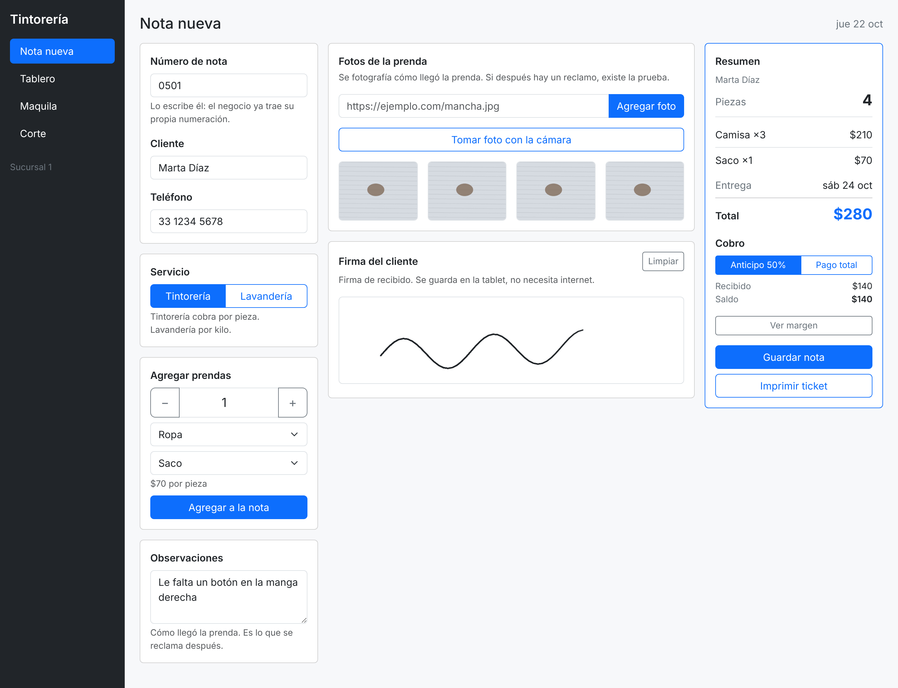
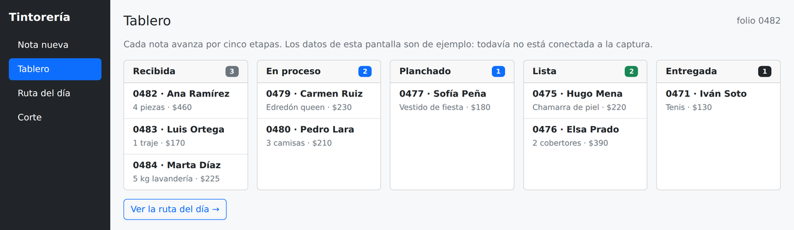
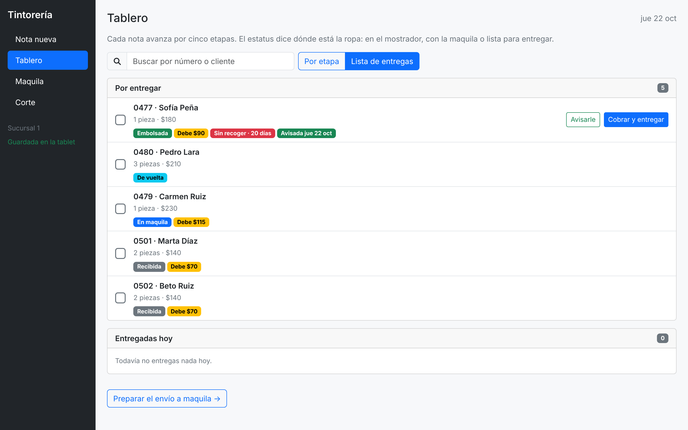
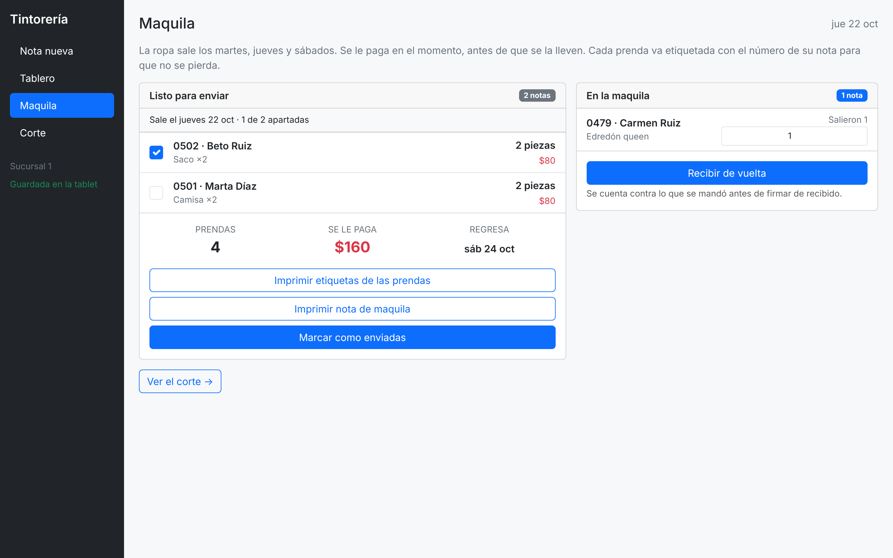
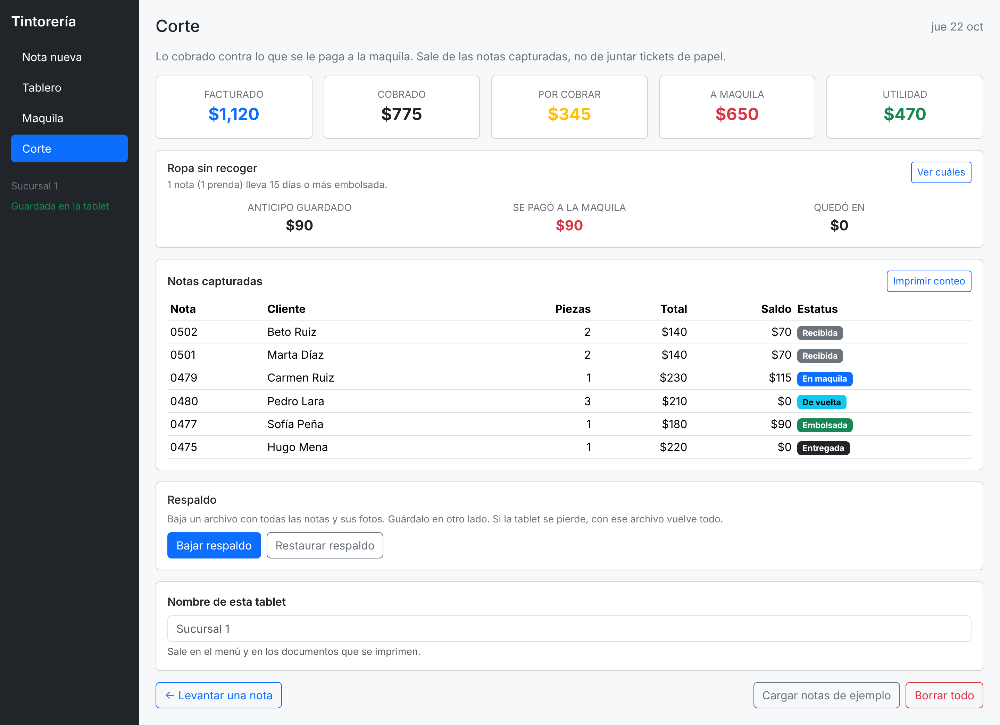
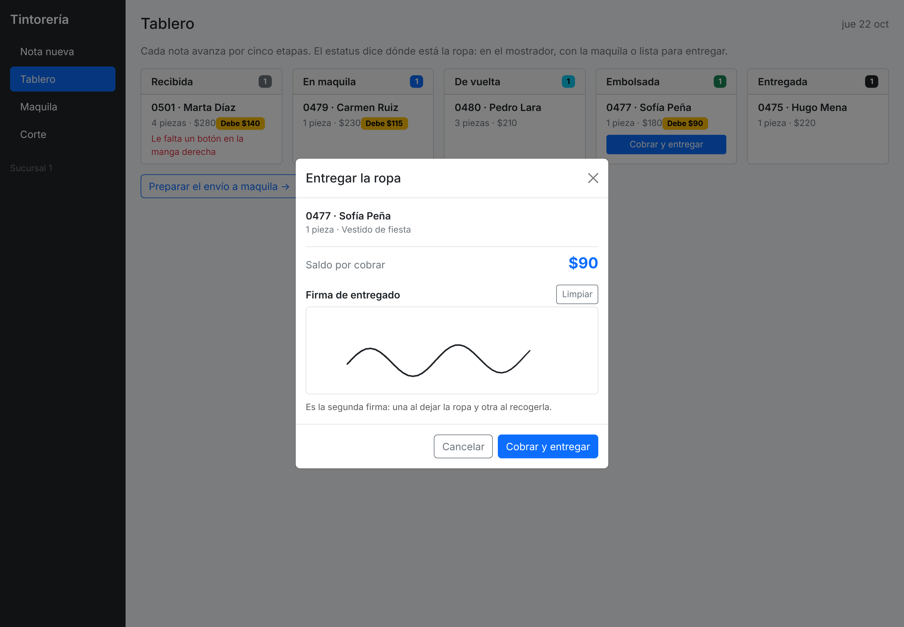
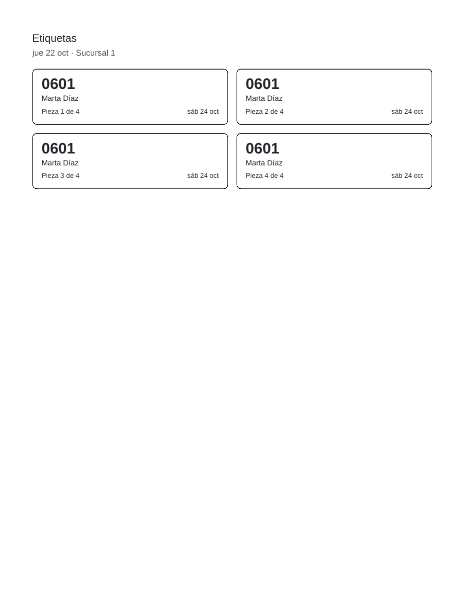
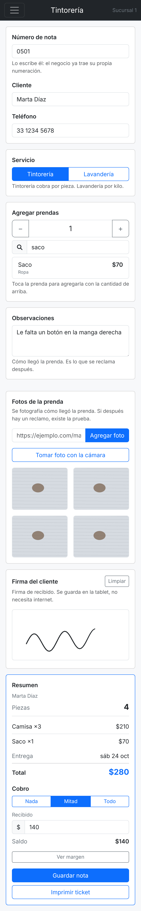
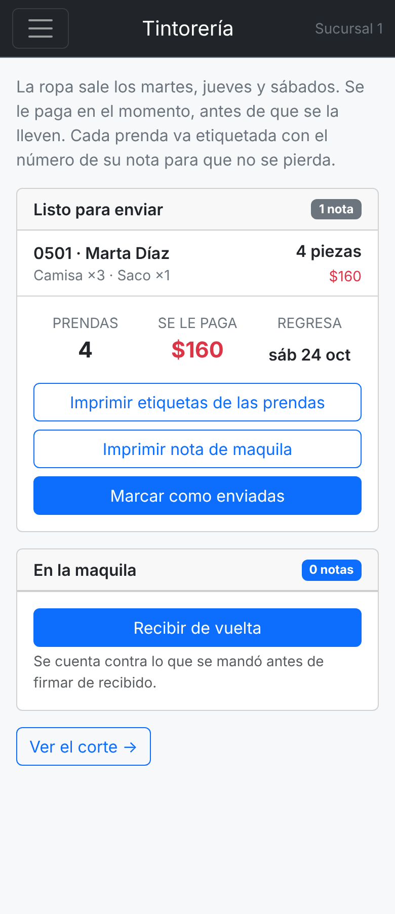

# Sistema de notas — tintorería y lavandería

Aplicación para una tintorería que manda la ropa a una maquila y la devuelve
etiquetada por número de nota. Hoy el negocio trabaja con libreta de papel.

**Ver la aplicación funcionando:** https://jorgeandrecuevas-dot.github.io/Tintorer-a-/

Lo que hace sale de los apuntes que se levantaron con el negocio el 22 de
octubre. Están en [APUNTES.md](APUNTES.md) y mandan sobre el código.

## Funciona sin internet

Es lo que pide el punto 20 de los apuntes. Bootstrap vive dentro del
proyecto y un service worker guarda la aplicación en la tablet, así que
abre en frío aunque no haya señal desde que se prende. Las notas se guardan
en el aparato.

Para comprobarlo: abre la página una vez, apaga el wifi y vuelve a entrar.
El menú lateral avisa cuándo está guardada y cuándo estás sin señal.

## Las cuatro pantallas

Se navega con el menú. En computadora es una barra lateral fija; abajo de
992 píxeles se vuelve un cajón que abre el botón de hamburguesa.

### 1. Nota nueva

- **El número de nota se escribe a mano.** El negocio ya trae su numeración.
- **Los clientes que ya vinieron se sugieren.** Escribes dos letras del
  nombre y sale, con su teléfono. Tocas uno y se llenan los dos campos. La
  señora que viene cada semana ya no se teclea cada semana.
- La cantidad va primero y en grande, con botones de más y menos para
  capturar de pie. Para la maquila pesa más cuántas prendas van que de qué
  tipo son.
- **Buscador de prendas con lupa.** Son 56 piezas y bajar una lista así de
  larga con el cliente enfrente tarda. Se escribe el nombre y sale. No pide
  acentos: «sabana» encuentra «Sábana».
- **Observaciones** de cómo llegó la prenda: botón que falta, rotura. Es lo
  que se reclama después.
- **Foto con la cámara**, que es como se toma en el mostrador. La foto se
  achica a 1000 píxeles y se guarda en IndexedDB, no en el almacén chico del
  navegador. El campo para pegar una dirección sigue ahí: es el requisito de
  la Actividad 1.
- **Firma del cliente** en la pantalla. No usa red ni biblioteca, y aguanta
  que giren la tablet.
- **El cobro se escribe.** Hay tres atajos (nada, mitad, todo) y abajo el
  campo del monto. El cliente da lo que trae, no siempre la mitad exacta.
  Si deja menos del 50% la pantalla lo avisa, y no deja recibir más de lo
  que vale la nota.
- La **fecha de entrega se calcula sola** con el ciclo de la maquila.

### 2. Tablero

Cinco etapas: recibida, en maquila, de vuelta, embolsada y entregada. Las
notas con saldo traen su marca, las observaciones se ven desde aquí, y lo
que no regresó completo de la maquila sale marcado en rojo.

**Lista de entregas.** El botón de arriba cambia las columnas por una lista de
lo que falta darle a la gente. Primero lo embolsado, y dentro de eso lo que
más lleva esperando. Cada nota trae su casilla, que se llena cuando la ropa
sale. Abajo, lo que ya se entregó hoy. Es el punto 11 de los apuntes.

**Avisarle al cliente.** La ropa embolsada trae un botón que abre WhatsApp con
el mensaje escrito: «Hola Marta, tu ropa ya está lista (nota 0501). Pasa por
ella cuando quieras. Quedan $90 por pagar.» Solo le das enviar. La nota queda
marcada como avisada. Sin teléfono, el botón dice que falta. La app no manda
nada sola: el mensaje sale de la cuenta del negocio. Una nota que regresa de
la maquila trae su botón **Ya está embolsada** para pasar a la siguiente.

**Se busca por número o por cliente.** Escribes «0502» o «sofia» y sale, sin
pedir acentos. Con 90 notas al mes recorrer cinco columnas con el dedo tarda
más que teclear.

**Toca una nota y se abre.** Ahí se corrige el número, el cliente, el
teléfono, las observaciones, la etapa y lo recibido. Se ven sus fotos y sus
firmas, se reimprime el ticket y se borra la nota. En el mostrador se teclea
mal y antes no había manera de arreglarlo.

### 3. Maquila

Lo que sale, cuántas prendas son y cuánto se le paga en el momento.

Arriba de la lista dice qué día sale y cuántas notas lleva apartadas: «Sale el
martes 27 oct · 2 de 4 apartadas». El lunes en la noche él va palomeando lo
que ya dejó en la bolsa (punto 15). La casilla es para acordarse. No impide
mandar la ropa.

Al recibir de vuelta, cada nota trae una casilla con lo que salió para
contar lo que regresó. Si no cuadra, la nota queda marcada. Eso es el
control del punto 2: que no se pierda ropa en la maquila.

### 4. Corte

Facturado, cobrado, por cobrar, lo pagado a la maquila y la utilidad. Sale
de las notas capturadas, no de juntar tickets.

**Ropa sin recoger.** Cuando dejan el anticipo y no regresan, la maquila ya se
pagó y no hay ganancia. Esa es la merma del punto 23. Una nota con 15 días
embolsada o más cuenta como sin recoger. Corte dice cuántas son, cuánto
anticipo se quedó, cuánto se le pagó a la maquila por esa ropa y en cuánto
quedó. El botón **Ver cuáles** las enseña en la lista de entregas. Los 15 días
son una suposición hasta que el dueño diga cuántos son.

**Aviso de respaldo.** Si llevan 7 días sin bajarlo, sale un aviso arriba en
cualquier pantalla con el botón para bajarlo. El primer día con notas no
avisa.

**Nombre de la tablet.** Dice «Sucursal 1» y se cambia ahí mismo. Sale en el
menú y en los documentos. Cuando abran la segunda, cada tablet lleva su
nombre.

## Las dos firmas

El punto 20 pide firmar de recibido y de entregado. La primera se levanta al
capturar la nota. La segunda, cuando el cliente viene por su ropa: desde el
tablero se cobra el saldo y firma. Sin firma no deja entregar.

## El ciclo de la semana

La ropa sale los martes, jueves y sábados, y vuelve en la salida siguiente:

| Sale | Vuelve |
|---|---|
| martes | jueves |
| jueves | sábado |
| sábado | martes |

Los cobertores y edredones tardan más, así que saltan un ciclo. La fecha de
entrega de cada nota se calcula con esta regla.

## Los cuatro documentos

El mismo pedido contado de varias maneras, que es como lo pidió el negocio:

| Documento | Para quién | Qué lleva |
|---|---|---|
| Ticket | Cliente | Qué dejó, total, anticipo, saldo y su firma |
| Nota de maquila | Maquila | Cuántas prendas van, cuánto se le paga |
| Etiquetas | La ropa | Una por prenda, con el número de nota |
| Conteo | El dueño | Cobrado contra pagado, y lo que quedó |

## Cómo se adapta a cada dispositivo

| Nota nueva en teléfono | Maquila en teléfono |
|---|---|
|  |  |

La galería de fotos pasa de 2 columnas en teléfono a 3 en tableta y 4 en
computadora. Lo hacen tres clases de Bootstrap,
`row-cols-2 row-cols-md-3 row-cols-lg-4`, sin una sola regla de CSS propia.

## Archivos

| Archivo | Qué tiene |
|---|---|
| `index.html` | Las cuatro pantallas, el cuadro de entrega y el menú |
| `styles.css` | El menú lateral, las miniaturas, las firmas y las hojas que se imprimen |
| `script.js` | Navegación, ciclo de la maquila, catálogo, cobro, firmas, conteo, documentos, almacén de imágenes y respaldo |
| `sw.js` | Guarda la aplicación en la tablet para que abra sin señal |
| `manifest.webmanifest` | Para instalarla como aplicación en la tablet |
| `vendor/` | Bootstrap, dentro del proyecto y no desde internet |
| `APUNTES.md` | Cómo funciona el negocio, en sus palabras |

## Dónde está cada requisito de la Actividad 1

Todo en la sección «1. GALERÍA DE FOTOGRAFÍAS» de `script.js`.

| Requisito | Dónde |
|---|---|
| Campo de texto para la URL | `index.html` → `id="urlFoto"`, clase `form-control` |
| Botón para agregar | `index.html` → `id="btnAgregar"`, clases `btn btn-primary` |
| Contenedor de la galería | `index.html` → `id="galeria"` |
| Rejilla responsiva | `row-cols-2 row-cols-md-3 row-cols-lg-4` |
| `addEventListener` | `script.js` → en el clic de `btnAgregar` |
| `document.createElement()` | `script.js` → en `agregarFoto`, crea la columna y la imagen |
| `appendChild()` | `script.js` → mete la imagen en la columna y la columna en la galería |

Los tres identificadores son únicos.

## Cómo probarlo

Entra a la liga de arriba. También abre con doble clic en `index.html`, pero
así no queda guardada en el aparato: el service worker necesita que la página
venga de un servidor.

La aplicación abre vacía. En la pantalla de **Corte** hay dos botones para
probarla: **Cargar notas de ejemplo** mete 4 notas de muestra y **Borrar
todo** deja la tablet limpia. Las notas que captures se guardan en el navegador y siguen
ahí al recargar.

## Sobre los precios

El catálogo son las 56 piezas de la lista que entregó el dueño. El costo de
cada pieza es lo que la maquila cobra por lavarla.

La lavandería no está como tabla sino como fórmula: los 30 renglones de la
hoja responden a `precio = 45 × kilos` sin excepción. El costo sí tiene una:
un kilo cuesta $32 en lugar de $48.

El botón **Ver margen** arranca oculto porque el cliente está viendo la
pantalla cuando se levanta la nota.

La sábana de una pieza estaba en $70 y la maquila cobra $100 por lavarla. Se
corrigió a $100 el 22 de octubre. Queda sin ganancia en esa pieza: cobra lo
mismo que cuesta.

El anticipo de 50% tampoco cubre la maquila en 45 de las 56 piezas. En una
camisa el cliente deja $35 y la maquila cobra $40. En un vestido de novia de
$1,200 deja $600 y la maquila cobra $800. Si no recogen, esa diferencia se
pierde. Está en Pendientes.

## Dónde vive cada cosa

Las imágenes salieron del almacén chico del navegador. Antes una nota con
cuatro fotos pesaba 1,032 KB ahí dentro y solo cabían 4 notas. Ahora:

| | Dónde | Cuánto pesa |
|---|---|---|
| Los datos de la nota | localStorage | 331 bytes |
| Las fotos y las firmas | IndexedDB | lo que aguante el disco |

Probadas 4,000 notas sin que truene, contra las 4 de antes. Las notas
guardadas con la versión anterior se mudan solas la primera vez que abre.

## El respaldo

En **Corte** hay dos botones. **Bajar respaldo** saca un archivo con todas
las notas y sus imágenes. **Restaurar respaldo** lo vuelve a meter, en esta
tablet o en otra.

Es lo único que salva al negocio si la tablet se pierde, se moja o alguien le
borra los datos del navegador. Hay que bajarlo seguido y guardarlo fuera.

## Pendientes

### 1. Sincronizar entre sucursales

Hoy es una sola. Cuando abran la segunda, las dos tablets no se hablan. El
corte no va a cuadrar y hace falta un servidor. El respaldo sirve para pasar
la libreta de una tablet a otra, no para que trabajen al mismo tiempo.

### 2. La merma del anticipo

Ya se mide. Falta decidir cómo evitarla. Hay dos ideas y las dos son del
dueño:

- Que el anticipo mínimo sea lo que cuesta la maquila, no el 50% fijo. Hoy
  no cubre en 45 de 56 piezas.
- Un cargo por almacenaje que empiece unos días después de la fecha prometida
  y que salga impreso y firmado en el ticket.

La fecha prometida ya se guarda completa en cada nota nueva, para poder
contar de ahí.

### 3. Quién paga lo que la maquila pierde o maltrata

Pendiente de preguntar. Cuando se sepa, la nota de maquila y el conteo lo
llevan.

### 4. El punto 14

A veces van ellos a la maquila y a veces vienen por la ropa. Falta que el
dueño confirme cómo es, para saber si cambia algo en pantalla.

Lo demás está en [MEJORAS.md](MEJORAS.md): los 23 apuntes uno por uno y los
tres caminos para seguir.
