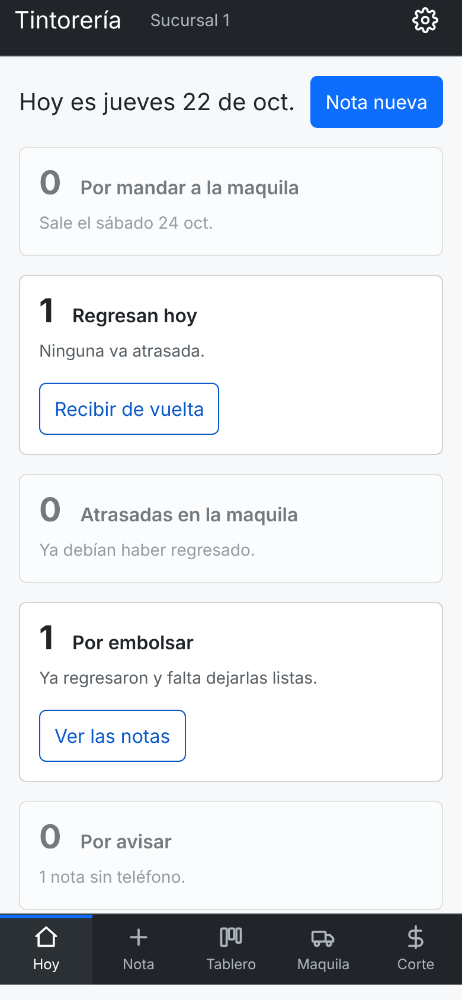
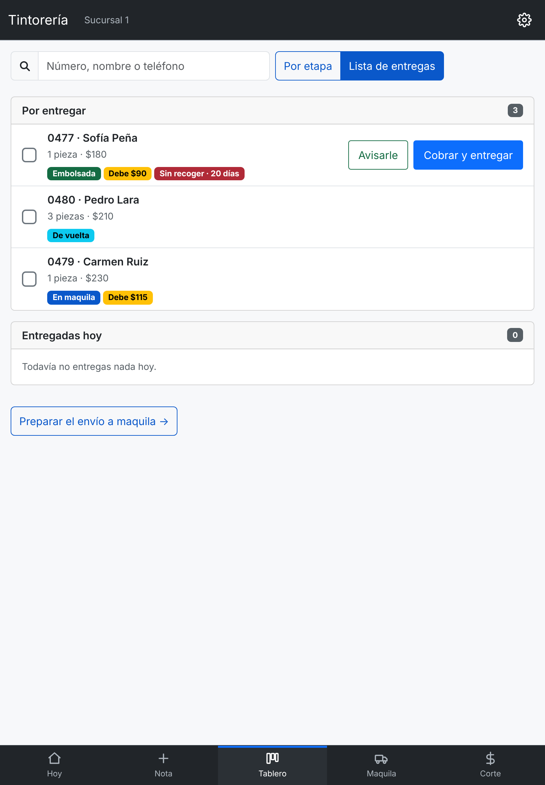
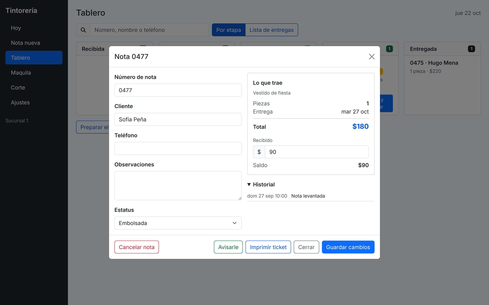
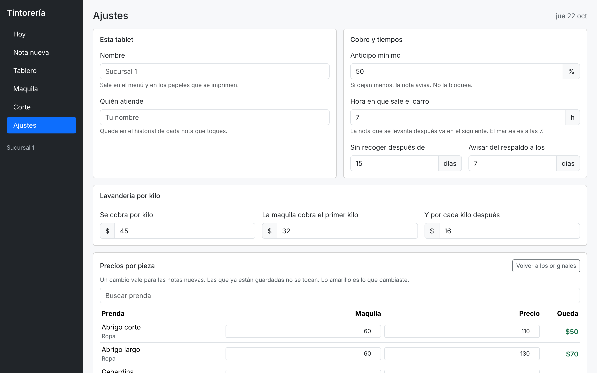

# Sistema de notas: tintorería y lavandería

Aplicación para una tintorería que manda la ropa a una maquila y la recibe
etiquetada por número de nota. Hoy el negocio trabaja con libreta de papel.

**Ver la aplicación funcionando:** https://jorgeandrecuevas-dot.github.io/Tintorer-a-/

Lo que hace sale de los apuntes que se levantaron con el negocio el 22 de
octubre. Están en [APUNTES.md](APUNTES.md) y mandan sobre el código.

## Funciona sin internet

Es lo que pide el punto 20 de los apuntes. Bootstrap vive dentro del
proyecto y un service worker guarda la aplicación en la tablet. Abre en frío
aunque no haya señal. Las notas se guardan en el aparato.

Para comprobarlo: abre la página una vez, apaga el wifi y vuelve a entrar.

**En iPad.** Instálala en la pantalla de inicio (Compartir, «Agregar a
inicio») y úsala siempre desde ahí. La app instalada y Safari **no comparten
notas**. La app pide almacenamiento persistente para que iOS no la borre a
los 7 días. Todavía no se ha probado en un iPad de verdad.

## Las seis pantallas

En computadora hay una barra lateral. En teléfono y iPad vertical (menos de
992 px) hay pestañas abajo: Hoy, Nota, Tablero, Maquila y Corte. Ajustes
está en el engrane de arriba.

### 1. Hoy



Lo primero que se ve es lo que toca hacer. Siete tarjetas con su número:
Por mandar a la maquila, Regresan hoy, Atrasadas en la maquila, Por
embolsar, Por avisar, Por entregar y Sin recoger. Cada una trae un botón que
lleva a donde se resuelve. Sin notas, el botón dice «Levantar la primera».

### 2. Nota nueva


- **El número de nota se escribe a mano.** El negocio ya trae su numeración.
  Si se repite, la pantalla avisa.
- **Los clientes que ya vinieron se sugieren.** Dos letras y sale el nombre
  con su teléfono.
- **La cantidad va primero**, con más y menos para capturar de pie.
- **Buscador de prendas.** Son 56 piezas. No pide acentos.
- **Lavandería por kilo.** No acepta 0 ni negativos.
- **Observaciones** de cómo llegó la prenda: botón que falta, rotura.
- **Cámara primero.** El campo para pegar una dirección de imagen queda
  plegado abajo, con los mismos identificadores. Es el requisito de la
  Actividad 1.
- **Firma del cliente** en la pantalla.
- **El cobro se escribe.** Tres atajos (nada, mitad, todo) y el monto. Si
  deja menos del anticipo mínimo avisa. No deja cobrar más de lo que vale.
- **La barra de abajo** lleva el total, el saldo y «Guardar nota». Siempre a
  la vista, aunque la nota mida más que la pantalla.
- La **fecha de entrega se calcula sola**, con la hora a la que sale el carro.

### 3. Tablero


Cinco etapas: recibida, en maquila, de vuelta, embolsada y entregada. Lo que
no regresó completo sale marcado en rojo. Se busca por número, cliente o
teléfono.

**Lista de entregas.** Cambia las columnas por lo que falta darle a la gente.



**Avisarles (N).** Con la ropa embolsada, un botón abre WhatsApp con el
primer mensaje escrito. Al volver ya trae al siguiente. Saltar lo deja sin
avisar. La app no manda nada sola.

**Toca una nota y se abre.** Se corrige todo, se ve su historial (quién
cambió qué y cuándo), se reimprime el ticket y se **cancela**.



Una nota cancelada no se borra. Guarda su motivo, baja a la caja
«Canceladas» del tablero y se puede reactivar. Si se devolvió lo cobrado, queda como un pago
negativo.

### 4. Maquila


Lo que sale, cuántas prendas son y cuánto se le paga. Dice qué día sale y
cuántas notas van apartadas. Al recibir de vuelta, cada nota trae su casilla
con lo que salió para contar lo que regresó. Si no cuadra, queda marcada.

### 5. Corte


Facturado, cobrado, por cobrar, lo pagado a la maquila y la utilidad. Se ve
por **Hoy, Esta semana, Este mes o Todo**. Lo cobrado sale de los pagos con
fecha, no de un solo número por nota.

- **Ropa sin recoger.** La merma del punto 23: se quedó el anticipo y la
  maquila ya se pagó. Cuenta como sin recoger la nota embolsada hace 15 días
  o más (se cambia en Ajustes).
- Una nota cancelada no se factura. Lo ya cobrado y lo ya pagado a la
  maquila se queda, porque ese dinero ya se movió.
- **Respaldo.** Aviso arriba si llevan 7 días sin bajarlo.

### 6. Ajustes



Lo que antes era editar el código:

- Nombre de la sucursal y quién atiende (queda en el historial de cada nota).
- Anticipo mínimo, hora de salida, días de sin recoger y de respaldo.
- Lavandería: lo que se cobra por kilo y lo que cobra la maquila.
- Los precios y costos de las 56 piezas. Lo cambiado se marca y se puede
  volver a los originales.

Se guarda en la tablet y va dentro del respaldo.

## Las dos firmas


El punto 20 pide firmar de recibido y de entregado. La primera se levanta al
capturar la nota. La segunda, cuando el cliente viene por su ropa. Sin firma
no deja entregar.

## El ciclo de la semana

La ropa sale los martes, jueves y sábados, y vuelve en la salida siguiente.

| Sale | Vuelve |
|---|---|
| martes | jueves |
| jueves | sábado |
| sábado | martes |

Los cobertores y edredones saltan un ciclo. El martes sale a las 7 am. La
hora de jueves y sábado es una suposición (7) hasta que el dueño la diga. Se
cambia en Ajustes.

## Los cuatro documentos

| Documento | Para quién | Qué lleva |
|---|---|---|
| Ticket | Cliente | Qué dejó, total, anticipo, saldo y su firma |
| Nota de maquila | Maquila | Cuántas prendas van, cuánto se le paga |
| Etiquetas | La ropa | Una por prenda, con el número de nota |
| Conteo | El dueño | Cobrado contra pagado, y lo que quedó |


El ticket mide 10 cm de ancho. Si la impresora es de tickets de 80 mm se
corta. Falta saber cuál usan.

## Cómo está armado

Sin herramientas de build. El navegador lee los módulos tal cual
(`<script type="module" src="script.js">`). `script.js` solo importa los
demás y abre Hoy.

| Archivo | Qué hace |
|---|---|
| `js/agenda.js` | Qué toca hoy según el ciclo y las notas. Recibe notas y una fecha, devuelve números y listas. |
| `js/ajustes.js` | La pantalla de Ajustes. |
| `js/almacen.js` | Fotos y firmas en IndexedDB. |
| `js/avisos.js` | El aviso verde de «guardado». |
| `js/captura.js` | Nota nueva: prendas, cobro, clientes que ya vinieron y guardar. |
| `js/catalogo.js` | Las 56 piezas con precio y costo de maquila, y la fórmula de lavandería. |
| `js/ciclo.js` | Cuándo sale la ropa a la maquila y cuándo regresa. |
| `js/cola.js` | Avisar a varios clientes de corrido por WhatsApp. |
| `js/config.js` | Lo que se cambia sin tocar el código, y dónde se guarda. |
| `js/confirmar.js` | El cuadro de «¿seguro?». Reemplaza al `confirm()` del navegador. |
| `js/corte.js` | Pantalla de Corte: periodo, pagos, sin recoger y canceladas. |
| `js/documentos.js` | Ticket, nota de maquila, etiquetas y conteo. |
| `js/dom.js` | `el()`: arma elementos sin escribir HTML a mano. |
| `js/entrega.js` | Entregar: cobrar el saldo y firmar de entregado. |
| `js/firmas.js` | Firmas con el dedo, sin red ni bibliotecas. |
| `js/galeria.js` | **Actividad 1**: la galería de fotografías y la foto con la cámara. |
| `js/hoy.js` | Pantalla de inicio: qué toca hoy. |
| `js/maquila.js` | Lo que sale, lo que se paga y el conteo de lo que regresa. |
| `js/mensajes.js` | A qué número y qué se le dice al cliente. Sin pantalla. |
| `js/modalNota.js` | Ver y corregir una nota desde el tablero. |
| `js/navegacion.js` | Las pantallas, el menú y las pestañas de abajo. |
| `js/notas.js` | Las notas guardadas, sus etapas, pagos, historial y versión de los datos. |
| `js/respaldo.js` | Bajar y restaurar el respaldo, y el recordatorio. |
| `js/resumen.js` | Las cuentas del corte. Sin pantalla, se prueba en Node. |
| `js/sinred.js` | Service worker, almacenamiento persistente y aviso de instalar en iPad. |
| `js/tablero.js` | Las cinco etapas, la lista de entregas y el buscador. |
| `js/utilidades.js` | `pesos`, `sinAcentos` y poco más. |
| `js/whatsapp.js` | Abre WhatsApp con el aviso escrito. |

Fuera de `js/`:

| Archivo | Qué tiene |
|---|---|
| `index.html` | Las seis pantallas, los cuadros y los menús |
| `styles.css` | Menú, pestañas, barra de guardar, firmas y hojas que se imprimen |
| `sw.js` | Guarda la aplicación para que abra sin señal |
| `manifest.webmanifest` | Para instalarla en la tablet |
| `vendor/` | Bootstrap, dentro del proyecto |
| `pruebas/` | Las pruebas |
| `herramientas/` | Los iconos y las capturas de este README |
| `APUNTES.md` | Cómo funciona el negocio, en sus palabras |
| `MEJORAS.md` | Los 23 apuntes uno por uno y lo que sigue |

Si agregas un módulo, ponlo también en la lista de `sw.js`. Una prueba avisa
si se te olvida.

## Dónde está cada requisito de la Actividad 1

Todo en `js/galeria.js`.

| Requisito | Dónde |
|---|---|
| Campo de texto para la URL | `index.html` → `id="urlFoto"`, clase `form-control` (dentro de `<details id="detallesUrl">`) |
| Botón para agregar | `index.html` → `id="btnAgregar"`, clases `btn btn-primary` |
| Contenedor de la galería | `index.html` → `id="galeria"` |
| Rejilla responsiva | `row-cols-2 row-cols-md-3 row-cols-lg-4` |
| `addEventListener` | `js/galeria.js` → en el clic de `btnAgregar` |
| `document.createElement()` | `js/galeria.js` → en `agregarFoto`, crea la columna y la imagen |
| `appendChild()` | `js/galeria.js` → mete la imagen en la columna y la columna en la galería |

Los tres identificadores son únicos.

## Las pruebas

```
npm install
npx playwright install chromium
npm run revisar     # ESLint
npm test            # Playwright
```

Son más de 440 pruebas. Corren en cuatro tamaños (unidades en Node, teléfono,
iPad y computadora). Abren la app de verdad, capturan notas, firman, cobran,
cancelan, y fallan si hay un error en la consola. Las cuentas del corte, el
ciclo y los ajustes se prueban también sin navegador.
`.github/workflows/pruebas.yml` las corre en cada subida.

Para volver a sacar las capturas: `node herramientas/capturas.mjs`.

## Cómo probarlo a mano

Entra a la liga de arriba. La aplicación abre vacía. En **Corte** hay dos
botones: **Cargar notas de ejemplo** mete 4 notas de muestra y **Borrar todo**
deja la tablet limpia. Las notas se guardan en el navegador y siguen ahí al
recargar.

## Sobre los precios

El catálogo son las 56 piezas de la lista del dueño. El costo de cada pieza
es lo que la maquila cobra por lavarla. Todo se cambia en Ajustes.

La lavandería es una fórmula: `precio = 45 × kilos`. La maquila cobra
$32 si es 1 kilo o menos, y $32 más $16 por cada kilo si es más.

La sábana de una pieza estaba en $70 y la maquila cobra $100. Quedó en $100
el 22 de octubre.

El anticipo de 50% no cubre la maquila en 45 de las 56 piezas. En una camisa
el cliente deja $35 y la maquila cobra $40. Si no recogen, esa diferencia se
pierde. Está en Pendientes.

## Dónde vive cada cosa

| | Dónde | Cuánto pesa |
|---|---|---|
| Los datos de la nota | localStorage | 330 a 410 bytes |
| Fotos y firmas | IndexedDB | lo que aguante el disco |
| Ajustes | localStorage | unos cientos de bytes |

Probadas 4,000 notas sin problema. Con 1,000 notas guardar tarda 9 ms.

Las notas llevan número de versión (`tintoreria.esquema`). Cuando la forma de
una nota cambia, las guardadas se arreglan una vez.

## El respaldo

En **Corte**: **Bajar respaldo** saca un archivo con notas, imágenes y
ajustes (versión 3). **Restaurar respaldo** lo vuelve a meter, en esta
tablet o en otra. Los respaldos de versiones anteriores también se restauran.

Es lo único que salva al negocio si la tablet se pierde o se moja. El
archivo trae nombres, teléfonos y firmas sin cifrar. Guárdalo fuera de la
tablet.

## Pendientes

Todos dependen del dueño o de un iPad de verdad. El detalle está en
[MEJORAS.md](MEJORAS.md).

1. **Probar en un iPad real:** impresión, cámara, almacenamiento, WhatsApp
   abierto desde la app instalada.
2. **Dos sucursales.** Hoy es una. Cuando abran la segunda hace falta un
   servidor, porque las tablets no se hablan.
3. **La merma del anticipo.** Ya se mide. Falta decidir si el anticipo
   mínimo es lo que cuesta la maquila, o si hay cargo por almacenaje.
4. **Quién paga lo que la maquila pierde o maltrata.**
5. **Punto 14.** Si el dueño cuenta y embolsa la ropa en su casa o la lleva
   lista al local.
6. **Hora de salida** de jueves y sábado, y **días** para dar una nota por
   sin recoger (hoy 15).
