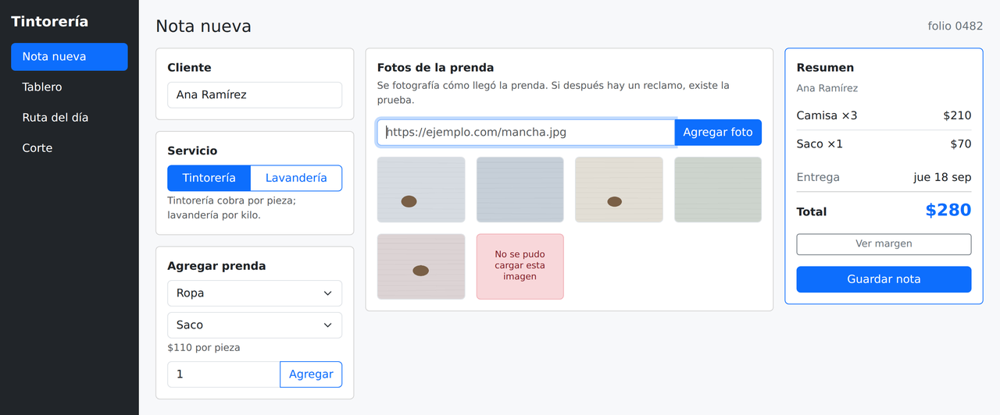
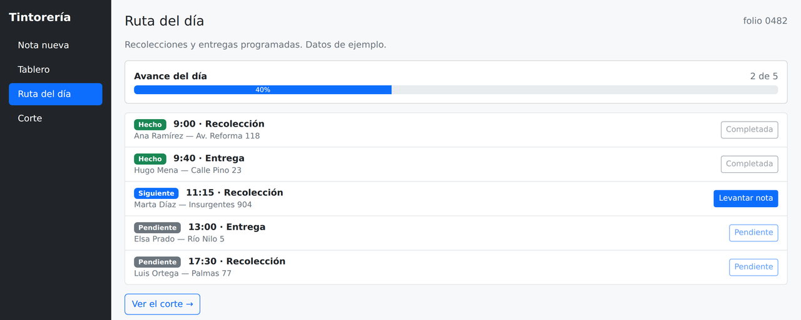
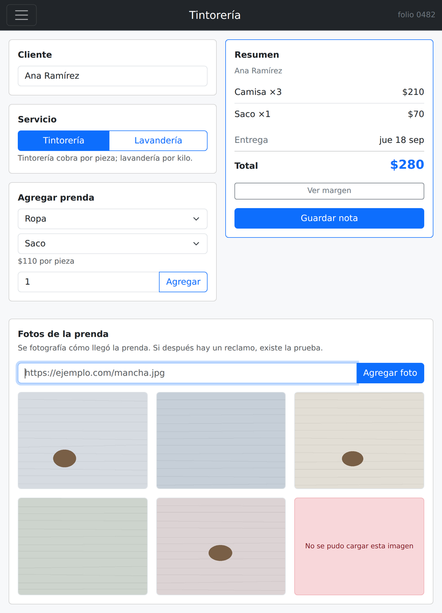
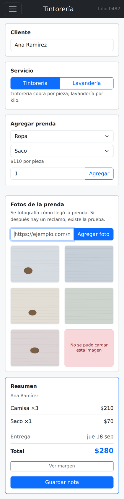

# Sistema de notas — tintorería y lavandería

Aplicación web para una tintorería que además da servicio de lavandería y
recoge la ropa a domicilio. Hoy el negocio trabaja con una libreta de papel;
esta aplicación la sustituye.

**Ver la aplicación funcionando:** https://jorgeandrecuevas-dot.github.io/Tintorer-a-/

Es el mismo archivo en los tres dispositivos. Lo único que cambia es el ancho
de la ventana.

## Las cuatro pantallas

Se navega entre ellas con el menú. En computadora el menú es una barra lateral
fija; abajo de 992 píxeles se convierte en un cajón que abre el botón de
hamburguesa. Además hay botones dentro de cada pantalla que llevan a la
siguiente.

### 1. Nota nueva

Se captura el cliente, el servicio, las prendas y las fotos. Es la única
pantalla con datos de verdad: el catálogo son las 56 piezas de la lista del
negocio. Aquí vive la galería de la Actividad 1.

### 2. Tablero

Las notas avanzan por cinco etapas. Datos de ejemplo.

### 3. Ruta del día

Recolecciones y entregas programadas, con el avance del día. Datos de ejemplo.

### 4. Corte

Ingresos, costo y utilidad del periodo. Datos de ejemplo.

## Cómo se adapta a cada dispositivo

| Tableta — 820 px | Teléfono — 390 px |
|---|---|
| Galería a 3 columnas | Galería a 2 columnas |
|  |  |

## Archivos

| Archivo | Qué tiene |
|---|---|
| `index.html` | Las cuatro pantallas y el menú |
| `styles.css` | Lo poco que no resuelve Bootstrap: el menú lateral y las miniaturas |
| `script.js` | La navegación, la galería, el catálogo y el cálculo del total |

## Dónde está cada requisito de la Actividad 1

Todo está en la sección «1. GALERÍA DE FOTOGRAFÍAS» de `script.js`.

| Requisito | Dónde |
|---|---|
| Campo de texto para la URL | `index.html` → `id="urlFoto"`, clase `form-control` |
| Botón para agregar | `index.html` → `id="btnAgregar"`, clases `btn btn-primary` |
| Contenedor de la galería | `index.html` → `id="galeria"` |
| Rejilla responsiva de Bootstrap | `row-cols-2 row-cols-md-3 row-cols-lg-4` |
| `addEventListener` | `script.js` → en el clic de `btnAgregar` |
| `document.createElement()` | `script.js` → crea la columna y la imagen |
| `appendChild()` | `script.js` → mete la imagen en la columna y la columna en la galería |

Los tres identificadores son únicos: no se repiten en el documento.

Las clases `row-cols-2 row-cols-md-3 row-cols-lg-4` son las que producen el
cambio de 2 a 3 y a 4 columnas. Bootstrap define `md` a partir de 768 píxeles
y `lg` a partir de 992. No se escribió ninguna regla de CSS propia para eso.

## Componentes de Bootstrap que se usan

Navbar, offcanvas, nav-pills, cards, list-group, badges, botones y grupos de
botones, formularios (`form-control`, `form-select`, `input-group`,
`btn-check`), tabla, barra de progreso, alerta, toast y el sistema de rejilla
con `order-*` para reacomodar las columnas según el ancho.

## Cómo probarlo

Abre `index.html` con doble clic, o entra a la liga de arriba. Necesita
internet porque Bootstrap se carga desde su CDN.

Para ver el comportamiento responsivo sin tener los tres aparatos: abre las
herramientas de desarrollador del navegador (F12) y activa la vista de
dispositivo.

En la pantalla de nota nueva, pega cualquier dirección de imagen en el campo y
presiona **Agregar foto**. Si la dirección no carga, en lugar de dejar un hueco
en blanco aparece un recuadro que dice «No se pudo cargar esta imagen»; eso
está en el `img.onerror` de `script.js` y no lo pedía la actividad.

## Sobre los precios

El catálogo de `script.js` son las 56 piezas de la lista real que entregó el
dueño del negocio, con su costo y su precio al público.

La lavandería no está guardada como tabla sino como fórmula, porque los 30
renglones de la hoja responden a `precio = 45 × kilos` sin ninguna excepción.
El costo sí tiene una: un kilo cuesta $32 en lugar de $48.

El botón **Ver margen** arranca oculto a propósito: el cliente está viendo la
pantalla cuando se levanta la nota en su domicilio.

## Pendientes

1. Conectar una base de datos. Hoy el botón **Guardar nota** avisa y lleva al
   tablero, pero la nota no se guarda en ningún lado.
2. Sustituir el campo de URL por la cámara del teléfono
   (`<input type="file" accept="image/*" capture>`).
3. Poder eliminar una foto capturada por error (`removeChild()`).
4. El tablero, la ruta y el corte muestran datos de ejemplo; falta
   alimentarlos con las notas capturadas.
